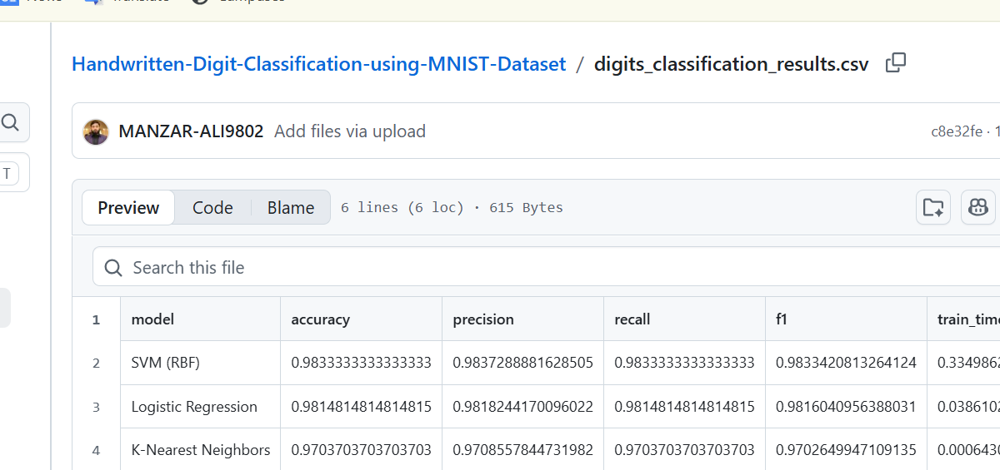

  <strong>Computer Engineering Student</strong> 
  Embedded Systems · IoT · Networking · Digital Logic Design · Cybersecurity

01 — About Me
I'm a Computer Engineering student at Pak-Austria Fachhochschule Institute of Applied Sciences and Technology, Pakistan, interested in the point where hardware, software, and connected systems meet.

I enjoy building and documenting practical work across embedded systems, IoT, digital logic design, FPGA development, and computer networking. I'm also developing my understanding of cybersecurity, with a particular interest in securing connected devices and networks.

This GitHub profile is my engineering workspace: a place to share projects, networking labs, coursework, experiments, and the skills I'm developing.
Engineering direction: connecting intelligent devices, reliable networks, and secure systems.

02 — Experience
Intern · Advanced Telecom Services (ATS) AI Lab
Jul 2026 – Oct 2026 · Remote, Pakistan
- Internship experience with cybersecurity listed among the associated skills.
Summer Intern · Revive Medical Technologies Inc.
Jul 2025 – Aug 2025 · Rawat, Islamabad · On-site
- Topics covered: Embedded C, Arduino IDE, communication protocols, PWM signals, clocks, Python, and Git/GitHub.
Frontend Web Developer Intern · ProSensia
Jun 2025 – Aug 2025 · Remote
- Frontend web development internship.
03 — Engineering Domains
- Embedded Systems & Microcontrollers
- Internet of Things (IoT)
- Computer Networking & Network Security
- Digital Logic Design & FPGA Development
- Cybersecurity Fundamentals
04 — Technical Skills
The technologies below reflect tools and languages I have worked with through coursework, projects, labs, or internships. This is a learning portfolio, not a claim of expert-level proficiency.
Programming & Hardware Description Languages
Language	Current level / focus
Python	Beginner–intermediate
C++	Beginner–intermediate
C	Beginner–intermediate
Embedded C	Beginner–intermediate
Verilog	Beginner–intermediate
RISC-V Assembly	Beginner–intermediate

Hardware, Embedded & Digital Design
- ESP32 and Arduino development
- Microcontroller programming and interfacing
- Sensors and IoT-based home automation
- Digital logic design and integrated circuits
- FPGA development concepts and Xilinx Vivado
- Basys 3 FPGA development board
Networking, Systems & Security
- Cisco Packet Tracer
- VLANs, switch port configuration, and trunking labs
- CCNA networking concepts
- Linux fundamentals and operating-system lab work
- Cybersecurity fundamentals
Tools & Platforms

05 — Certifications
Certification	Issuer	Status / verification
Networking Basics	Cisco Networking Academy	Verify credential · Issued Aug 2026
Introduction to Cybersecurity	Cisco Networking Academy	Verify credential · Issued Jul 2026
Embedded Systems using C	Coursera / EDUCBA	Verify credential · Issued Jul 2026
Ethical Hacking Essentials (EHE)	EC-Council	Certification added to profile

06 — Featured Projects
The project images below use the individual files uploaded to the repository root. Keep the filenames unchanged, or update the paths here if you rename them.
<table>
<tr>
<td width="50%" valign="top">

[Watch the ESP32 hardware demonstration video](HOME_AUTOMATION_PROT0TYPE_7.mp4)
ESP32 Smart Home Automation

An IoT home-automation project built around the ESP32 microcontroller.

ESP32 IoT Embedded Systems
</td>
<td width="50%" valign="top">

Handwritten Digit Classification — MNIST

A machine-learning project for classifying handwritten digits using the MNIST dataset.

Python Machine Learning MNIST
</td>
</tr>
<tr>
<td width="50%" valign="top">
**[Student Data Management Using Algorithms](https://github.com/MANZAR-ALI9802/Student-Data-Management-Using-Algorithms)**
A student data-management project applying data structures and algorithms to a practical problem.

C++ Data Structures Algorithms
</td>
<td width="50%" valign="top">

VLAN Segmentation & Trunking Lab

A Cisco Packet Tracer two-switch lab covering VLAN segmentation, trunk configuration, and connectivity verification.

Cisco Packet Tracer VLAN Trunking
</td>
</tr>
</table>07 — Currently Exploring
- CCNA networking concepts and practical Cisco labs
- Router-on-a-stick and inter-VLAN routing
- Network security and cybersecurity fundamentals
- Embedded development and IoT communication
- FPGA design with Xilinx Vivado and the Basys 3 board
- Verilog and RISC-V Assembly
08 — GitHub Activity

09 — Connect
I'm open to connecting with students, engineers, mentors, and developers interested in embedded systems, IoT, networking, digital design, and cybersecurity.
- LinkedIn: manzar-ali
- Email: sardarmanzarali3@gmail.com
- GitHub: MANZAR-ALI9802

From logic gates to connected systems — learning, building, and engineering forward.

